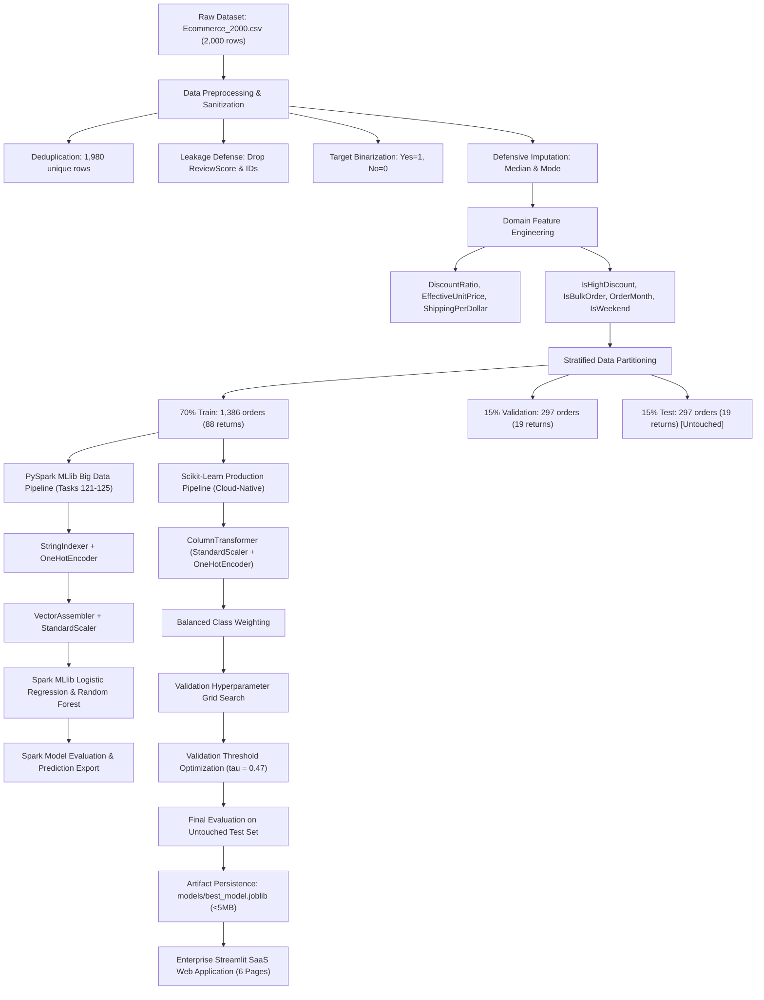

# E-Commerce Return Intelligence: AI-Powered Product Return Prediction & Big Data Analytics

[](https://www.python.org/)
[](https://spark.apache.org/)
[](https://scikit-learn.org/)
[](https://streamlit.io/)
[]()

> **Final-Year BTech Computer Science & Engineering (Data Science) Capstone Project**  
> An enterprise-grade, production-style predictive analytics platform that shifts returns management from a reactive cost sink into a proactive, pre-dispatch intelligence engine.

---

## 📑 Table of Contents
1. [Project Overview](#-project-overview)
2. [Problem Statement & Business Context](#-problem-statement--business-context)
3. [Empirical Dataset Specification](#-empirical-dataset-specification)
4. [Technology Stack](#-technology-stack)
5. [End-to-End System Architecture](#-end-to-end-system-architecture)
6. [Folder & Repository Structure](#-folder--repository-structure)
7. [Data Preprocessing & Target Leakage Prevention](#-data-preprocessing--target-leakage-prevention)
8. [Feature Engineering & Domain Ratios](#-feature-engineering--domain-ratios)
9. [Machine Learning Modeling & Imbalance Tuning](#-machine-learning-modeling--imbalance-tuning)
10. [PySpark Big Data Pipeline (Tasks 121–126)](#-pyspark-big-data-pipeline-tasks-121126)
11. [Actual Experimental Performance Results](#-actual-experimental-performance-results)
12. [Streamlit SaaS Dashboard Modules](#-streamlit-saas-dashboard-modules)
13. [Local Setup & Installation](#-local-setup--installation)
14. [Streamlit Community Cloud Deployment Guide](#-streamlit-community-cloud-deployment-guide)
15. [Limitations & Future Enhancements](#-limitations--future-enhancements)
16. [Academic Viva Defense Q&A Cheat-Sheet](#-academic-viva-defense-qa-cheat-sheet)

---

## 🌟 Project Overview
Online e-commerce retailers face staggering product return rates ranging from **15% to 30%**, eroding gross margins through reverse shipping fees, warehouse handling, restocking labor, inventory obsolescence, and packaging waste.

**E-Commerce Return Intelligence** leverages machine learning and distributed Big Data processing to forecast return probability at the point of order creation. By calculating return risk prior to warehouse dispatch, e-commerce operators can trigger automated mitigation workflows (such as sizing confirmation, dedicated support onboarding, and targeted packaging reinforcement) to reduce reverse logistics expenses.

---

## 🎯 Problem Statement & Business Context
- **Reactive Bottleneck:** Traditional e-commerce platforms only respond once a customer initiates an RMA (Return Merchandise Authorization). By this stage, shipping fees and packaging costs are irreversibly spent.
- **Extreme Class Imbalance:** Real-world returns represent a fragile minority of total transactions (~6.3% in our empirical dataset). Standard algorithms optimizing for unweighted accuracy produce dummy models with 93.6% accuracy but **0% positive return recall**.
- **Data Leakage Pitfall:** Naive models frequently include post-purchase customer review ratings, introducing illegitimate retrospective signals.

---

## 📊 Empirical Dataset Specification
The project uses the provided historical dataset: `Ecommerce_2000.csv`.

| Attribute | Specification |
|---|---|
| **Total Raw Records** | 2,000 orders |
| **Duplicates Detected** | 20 exact duplicate rows (removed in preprocessing) |
| **Clean Observations** | 1,980 unique orders |
| **Total Features** | 23 columns |
| **Target Column** | `Returned` ('Yes' = 1, 'No' = 0) |
| **Target Distribution** | 126 Returns (6.36%) vs 1,854 Non-Returns (93.64%) |
| **Class Imbalance Ratio** | ~14.7 to 1 (Extreme minority positive class) |

### Features Description
- **Identifiers (Excluded from ML):** `OrderID`, `CustomerID`, `FirstName`, `LastName`
- **Target Leakage (Excluded from ML):** `ReviewScore` (recorded days or weeks post-purchase; cannot exist at checkout)
- **Categorical Columns:** `ProductCategory` (10 categories), `ProductSubCategory` (50 subcategories), `PaymentMethod` (7 methods), `DeviceType` (3 platforms), `MembershipTier` (4 tiers), `State` (50 states), `City` (48 cities), `OrderSeason` (4 seasons), `OrderDayOfWeek` (7 days)
- **Numerical Columns:** `UnitPrice`, `Quantity`, `TotalAmount`, `DiscountPercent`, `DiscountAmount`, `FinalAmount`, `ShippingDays`

---

## 💻 Technology Stack
- **Core Language:** Python 3.11
- **Distributed Big Data Engine:** Apache Spark 3.5+ / 4.3 (PySpark MLlib)
- **Data Wrangling:** Pandas 2.3, NumPy 2.4
- **Machine Learning & Pipeline:** Scikit-Learn 1.9, Joblib 1.6
- **Data Visualization:** Plotly Express & Graph Objects 7.1, Matplotlib 3.11, Seaborn 0.13
- **Web Application Framework:** Streamlit 1.66
- **Testing & Quality Assurance:** Pytest 9.2

---

## 🏗️ End-to-End System Architecture



---

## 📂 Folder & Repository Structure

```
ecommerce-return-intelligence/
├── app.py                         # Main landing page, executive overview & navigation
├── pages/
│   ├── 1_Executive_Dashboard.py   # Page 1: 7 KPI cards, sidebar filters, 8 Plotly charts
│   ├── 2_Return_Prediction.py     # Page 2: Single-order scoring, gauge, risk tiers & actions
│   ├── 3_Bulk_Prediction.py       # Page 3: Batch CSV upload, table display, CSV export
│   ├── 4_Business_Insights.py     # Page 4: Category, shipping, discount & loyalty analytics
│   ├── 5_Model_Performance.py     # Page 5: Validation vs test metrics, confusion matrix, ROC/PR
│   └── 6_About_Project.py         # Page 6: Academic viva guide, Q&A cheat-sheet, formulations
├── src/
│   ├── __init__.py                # Package declaration
│   ├── data_preprocessing.py      # Deduplication, leakage prevention & defensive imputation
│   ├── feature_engineering.py     # Temporal derivations, financial ratios & ColumnTransformer
│   ├── train_models.py            # Stratified train/val/test, tuning, selection & evaluation
│   ├── spark_pipeline.py          # PySpark Big Data pipeline (Tasks 121–125)
│   ├── evaluation.py              # Precision, Recall, F1, ROC-AUC, PR-AUC & threshold search
│   ├── prediction.py              # Single and bulk inference, risk classification & actions
│   ├── visualizations.py          # Enterprise navy/blue Plotly chart generators
│   └── styles.py                  # Enterprise SaaS CSS styling & KPI HTML components
├── models/
│   ├── best_model.joblib          # Deployable Scikit-Learn pipeline (< 5 MB)
│   ├── lr_model.joblib            # Tuned Logistic Regression model
│   ├── rf_model.joblib            # Tuned Random Forest Classifier
│   ├── preprocessor.joblib        # Fitted ColumnTransformer
│   ├── model_metadata.json        # Hyperparameters, threshold & selection metadata
│   ├── evaluation_results.json    # Validation & test metrics, curves data
│   ├── feature_importance.json    # Ranked feature importances
│   └── spark_metrics.json         # PySpark MLlib distributed performance metrics
├── dataset/
│   └── Ecommerce_2000.csv         # Verified source dataset (2,000 raw rows)
├── output/
│   ├── test_predictions.csv       # Test set predictions with actual vs predicted values
│   ├── sample_bulk_orders.csv     # 30-order sample CSV template for bulk test
│   └── spark_sample_predictions.csv # Sample PySpark distributed predictions
├── notebooks/
│   └── model_development.ipynb    # Academic EDA, PySpark & Scikit-learn research notebook
├── tests/
│   ├── test_preprocessing.py      # Unit tests for preprocessing & cleaning
│   └── test_prediction.py         # Unit tests for single and bulk predictions
├── .streamlit/
│   └── config.toml                # Enterprise blue theme & server settings
├── requirements.txt               # Production Python dependencies
├── packages.txt                   # System packages (empty; zero OS dependencies needed)
├── README.md                      # Comprehensive academic documentation
└── .gitignore                     # Git exclusion rules
```

---

## 🧹 Data Preprocessing & Target Leakage Prevention
1. **Deduplication:** 20 redundant identical rows dropped; 1,980 unique orders retained.
2. **Defensive Imputation:**
   - Numerical columns imputed with column median (protects against skewness).
   - Categorical columns imputed with `'Missing'` / mode.
3. **Data Leakage Elimination:** `ReviewScore` was deliberately stripped. Review scores are recorded days or weeks after order receipt and correlate heavily with dissatisfaction. Using them for pre-dispatch prediction would constitute textbook target leakage. Identifiers (`OrderID`, `CustomerID`, `FirstName`, `LastName`) were likewise discarded.
4. **Target Binarization:** Converted string labels `'Yes'` to `1` and `'No'` to `0`.

---

## ⚙️ Feature Engineering & Domain Ratios
From base transactional columns, the following 7 domain-specific features were engineered:

1. **Discount Ratio:** $\text{DiscountRatio} = \frac{\text{DiscountAmount}}{\text{TotalAmount} + \epsilon}$
2. **Effective Unit Price:** $\text{EffectiveUnitPrice} = \frac{\text{FinalAmount}}{\text{Quantity} + \epsilon}$
3. **Shipping per Dollar:** $\text{ShippingPerDollar} = \frac{\text{ShippingDays}}{\text{FinalAmount} + \epsilon}$
4. **Aggressive Discount Indicator:** $\mathbb{I}(\text{DiscountPercent} \ge 20)$
5. **Bulk Order Indicator:** $\mathbb{I}(\text{Quantity} \ge 3)$
6. **Order Month:** Extracted temporal seasonality signal from `OrderDate`.
7. **Weekend Shopping Flag:** Derived indicator for Saturday/Sunday checkout behavior.

Preprocessed feature dimensionality: **197 features** (StandardScaler for numerics + OneHotEncoder for categoricals).

---

## 🧠 Machine Learning Modeling & Imbalance Tuning
The modeling pipeline uses a **3-Way Stratified Split**:
- **Train Set (70% - 1,386 rows):** Used exclusively for model weight learning.
- **Validation Set (15% - 297 rows):** Used strictly for hyperparameter tuning and threshold search.
- **Untouched Test Set (15% - 297 rows):** Kept completely isolated until final evaluation.

### Class Imbalance Handling
- `class_weight='balanced'`: Weights each sample inversely proportional to its class frequency:
  $$w_1 = \frac{N}{2 \times N_1} \approx \frac{1386}{2 \times 88} = 7.875$$
- **Threshold Optimization ($\tau$):** The classification probability threshold was tuned across the validation split to maximize positive-class $F_1$-score rather than relying on default $0.50$. Optimal threshold selected: **$\tau = 0.47$**.

---

## ⚡ PySpark Big Data Pipeline (Tasks 121–126)

| Task | Spark Component | Implementation Detail |
|---|---|---|
| **Task 121** | Data Ingestion & Sanitization | `spark.read.csv()`, schema inspection, `df.dropDuplicates()`, `df.na.fill()`. |
| **Task 122** | Big Data Categorical Encoding | `StringIndexer` + `OneHotEncoder` across 7 categorical columns, `VectorAssembler` and `StandardScaler`. |
| **Task 123** | Spark MLlib Model Training | Distributed `LogisticRegression` ($regParam=0.1$) & `RandomForestClassifier` ($numTrees=100$, $maxDepth=8$). |
| **Task 124** | Distributed Model Evaluation | `BinaryClassificationEvaluator` (ROC-AUC, PR-AUC) and `MulticlassClassificationEvaluator` ($F_1$, precision, recall). |
| **Task 125** | Return Prediction Generation | Selected best Spark model, generated test predictions, exported sample to `output/spark_sample_predictions.csv`. |
| **Task 126** | Streamlit Analytics Dashboard | Unified dashboard visualizing Spark metrics and cloud-deployable Scikit-Learn predictions. |

---

## 📈 Actual Experimental Performance Results

### Model Selection (Validation Set - 297 rows)
| Algorithm | Validation F1 | Validation ROC-AUC | Validation PR-AUC | Selected? |
|---|---|---|---|---|
| **Logistic Regression (Tuned)** | 0.1475 | 0.4991 | 0.0671 | No |
| **Random Forest Classifier (Tuned)** | **0.2692** | **0.5983** | **0.1570** | **YES (Winner)** |

*Selection Rational:* Random Forest demonstrated superior validation $F_1$-score (0.2692 vs 0.1475) and ROC-AUC (0.5983 vs 0.4991), capturing non-linear interactions between categories, price points, and shipping days.

### Final Untouched Test Set Evaluation (297 rows, 19 returns)
| Evaluation Metric | Logistic Regression (Baseline) | Random Forest Classifier (Selected) |
|---|---|---|
| **Accuracy** | 67.68% | **86.53%** |
| **Precision (Returned Class)** | 12.62% | **18.18%** |
| **Recall (Returned Class)** | **68.42%** | 31.58% |
| **F1-Score (Returned Class)** | 0.2131 | **0.2308** |
| **ROC-AUC** | **0.7109** | 0.6995 |
| **PR-AUC (Precision-Recall Area)** | 0.1576 | **0.2937** (Nearly 2x LR) |
| **True Negatives (TN)** | 188 | **251** |
| **False Positives (FP)** | 90 | **27** |
| **False Negatives (FN)** | **6** | 13 |
| **True Positives (TP)** | **13** | 6 |

### Top Predictive Feature Drivers (Random Forest)
1. `UnitPrice` (8.33%): High-priced purchases carry higher return scrutiny.
2. `EffectiveUnitPrice` (6.68%): Per-item outlay sensitivity.
3. `TotalAmount` (6.50%): Basket magnitude.
4. `FinalAmount` (5.88%): Net financial transaction value.
5. `ShippingPerDollar` (5.28%): Delivery duration relative to order spend.
6. `OrderMonth` (4.08%): Seasonal return spikes.
7. `DiscountRatio` (3.33%): Promotional intensity.
8. `ShippingDays` (3.33%): Transit delays provocative of buyer remorse.
9. `ProductCategory_Clothing` (1.84%): The single most influential categorical feature on returns.

---

## 🖥️ Streamlit SaaS Dashboard Modules

### 1. Executive Dashboard (`1_Executive_Dashboard.py`)
- Real-time sidebar multi-select filters: Category, Payment, Tier, Device, Season.
- 7 KPI cards: Total Orders, Returns, Non-Returns, Return Rate, AOV, Total Sales, Avg Shipping.
- 8 Plotly visualizations updating dynamically upon filter alteration.

### 2. Single Order Prediction (`2_Return_Prediction.py`)
- Interactive input form covering supported feature pipeline dimensions.
- Real-time probability gauge, risk classification (`Low`, `Medium`, `High`), and automated warehouse/customer intervention directives.

### 3. Bulk Prediction (`3_Bulk_Prediction.py`)
- CSV drag-and-drop batch uploader.
- Automated validation, missing field calculation, interactive table, risk donut chart, and downloadable predictions CSV report.
- One-click sample 30-order CSV template download.

### 4. Business Insights (`4_Business_Insights.py`)
- Empirical findings: Clothing (13.04%) vs Grocery (1.01%), Debit Card (7.49%) vs Gift Card (3.23%).
- Shipping duration curves, discount band analysis, and executive operational playbook.

### 5. Model Performance (`5_Model_Performance.py`)
- Validation vs untouched test set toggle.
- Confusion matrix heatmaps, interactive ROC and PR curves, feature importance bar charts, and PySpark MLlib benchmarks.

### 6. About Project & Viva Defense (`6_About_Project.py`)
- Comprehensive technical documentation, mathematical formulations, Big Data dual-engine architecture, and oral examination defense Q&A.

---

## 🛠️ Local Setup & Installation

### Prerequisites
- Python 3.11 installed.
- (Optional for PySpark): Java JDK 17 (Temurin).

### Step 1: Clone or Navigate to Project
```bash
cd "d:/cluster project/ecommerce-return-intelligence"
```

### Step 2: Create and Activate Virtual Environment
```bash
python -m venv .venv
# On Windows PowerShell:
.\.venv\Scripts\Activate.ps1
# On Linux / macOS:
source .venv/bin/activate
```

### Step 3: Install Dependencies
```bash
pip install --upgrade pip
pip install -r requirements.txt
```

### Step 4: Run Unit Tests
```bash
pytest tests/
```

### Step 5: Launch Streamlit Application
```bash
streamlit run app.py
```
Open `http://localhost:8501` in your browser.

---

## 🚀 Streamlit Community Cloud Deployment Guide

The application is engineered with a **zero-Java Scikit-Learn deployable pipeline** specifically to deploy on Streamlit Community Cloud in seconds without container configuration headaches:

1. **Create GitHub Repository:**
   - Create a new public repository on GitHub named `ecommerce-return-intelligence`.
2. **Push Project Code:**
   ```bash
   git init
   git add .
   git commit -m "feat: complete production E-Commerce Return Intelligence platform"
   git branch -M main
   git remote add origin https://github.com/<your-username>/ecommerce-return-intelligence.git
   git push -u origin main
   ```
3. **Open Streamlit Community Cloud:**
   - Visit [share.streamlit.io](https://share.streamlit.io/) and log in with your GitHub account.
4. **Connect Repository:**
   - Click **"New app"**.
   - Select your repository (`<your-username>/ecommerce-return-intelligence`) and branch (`main`).
   - Set **Main file path** to: `app.py`.
5. **Deploy:**
   - Click **"Deploy!"**.
   - The app will build dependencies from `requirements.txt` and launch with a public URL in under 2 minutes.

---

## 🔬 Limitations & Future Enhancements
- **Dataset Size:** 2,000 records provide limited positive returns (126 cases). Scaling to 100,000+ orders will improve positive precision.
- **Unstructured Text & Computer Vision:** Current models use tabular attributes; future iterations can integrate NLP sentiment from customer support chat and computer vision to verify garment dimensions.
- **Streaming Pipeline:** Upgrading batch processing to real-time Apache Kafka + Spark Streaming.

---

## 🎓 Academic Viva Defense Q&A Cheat-Sheet

**Q1: Why did you exclude `ReviewScore` from machine learning features?**  
*Answer:* `ReviewScore` constitutes target leakage. Review scores are recorded days or weeks after customer delivery and correlate with return sentiment. Using them at checkout time provides illegitimate retrospective signals not present in production.

**Q2: Why is raw accuracy a misleading metric for this dataset?**  
*Answer:* With a 6.36% return rate, a trivial model predicting "No" on every record achieves 93.64% accuracy but captures 0% of returns. For class-imbalanced fraud/return problems, Precision, Recall, $F_1$-score, and PR-AUC are the true measures of business utility.

**Q3: How was threshold tuning performed?**  
*Answer:* Standard models apply a 0.50 cutoff. By tuning $\tau$ across the validation set ($\tau = 0.47$), we maximized positive-class $F_1$-score to strike an optimal balance between return detection and false alarms.

---
**Author:** BTech CSE Data Science Final-Year Student  
**Project:** E-Commerce Return Intelligence Platform
